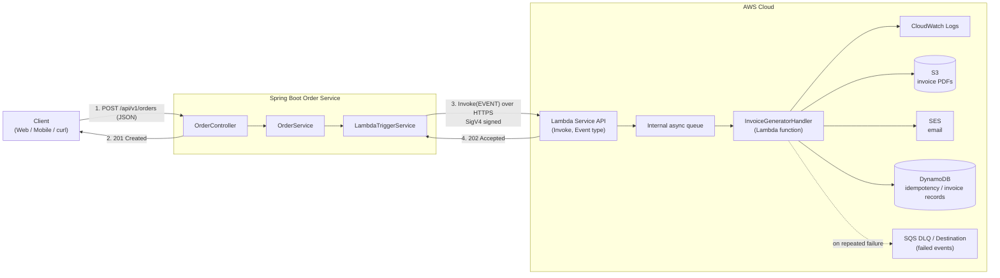
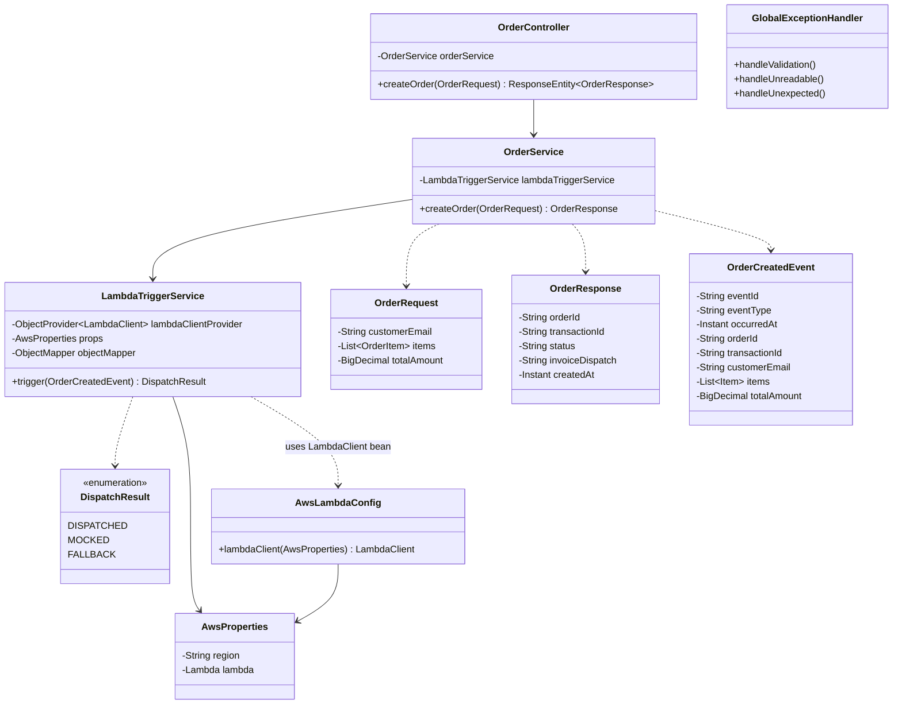
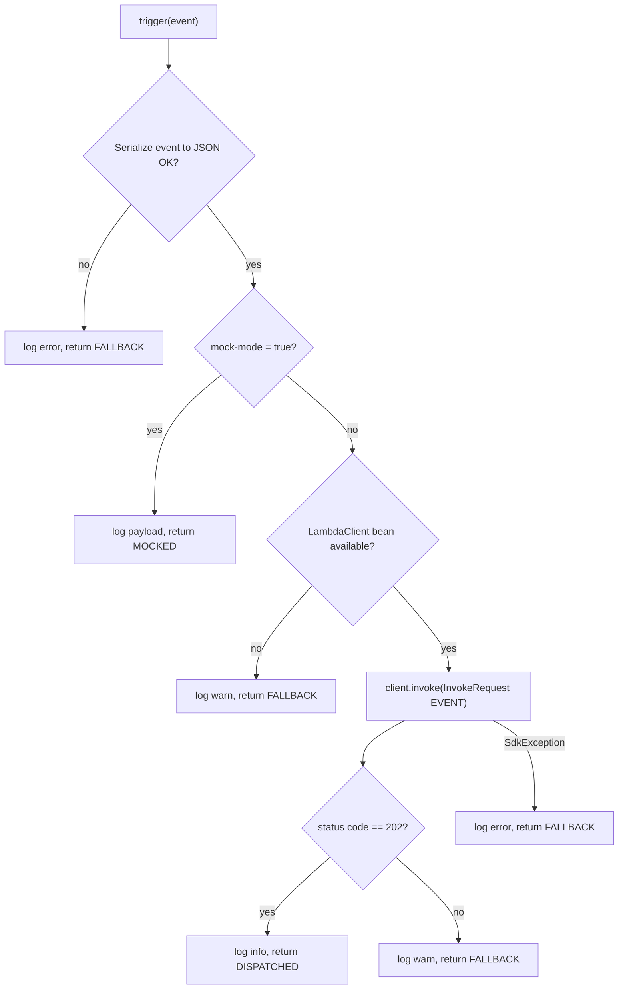
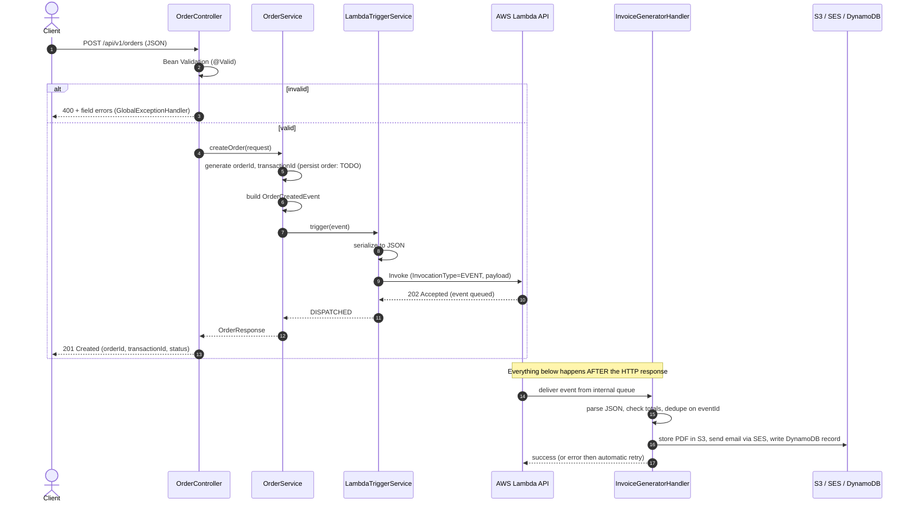
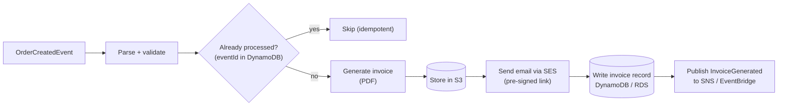
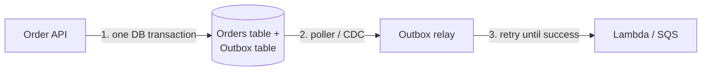

# order-lambda-trigger

A Spring Boot 3 (Java 17) service that receives an order over REST and **asynchronously triggers an AWS Lambda function** (`InvocationType.EVENT`) to do follow-up work, such as generating an invoice, without making the customer wait.

> **One-line summary:** `POST /api/v1/orders` → validate → create order → publish `OrderCreatedEvent` to Lambda (fire-and-forget) → return `201 Created` immediately.

---

## Table of Contents

1. [Why this project exists](#1-why-this-project-exists)
2. [Tech stack](#2-tech-stack)
3. [Repository layout](#3-repository-layout)
4. [High-Level Design (HLD)](#4-high-level-design-hld)
5. [Low-Level Design (LLD)](#5-low-level-design-lld)
6. [End-to-end request flow](#6-end-to-end-request-flow)
7. [Steps required to trigger the AWS Lambda](#7-steps-required-to-trigger-the-aws-lambda)
8. [Run it: local (mock) and real AWS](#8-run-it-local-mock-and-real-aws)
9. [What happens after the Lambda is triggered](#9-what-happens-after-the-lambda-is-triggered)
10. [Real-life usefulness and use cases](#10-real-life-usefulness-and-use-cases)
11. [Failure handling and reliability](#11-failure-handling-and-reliability)
12. [Production hardening checklist](#12-production-hardening-checklist)
13. [Troubleshooting](#13-troubleshooting)

---

## 1. Why this project exists

When a customer places an order, several things must happen: save the order, generate an invoice, send an email, update analytics, notify the warehouse, and so on. If the API does all of that inside the request, then:

- the customer waits longer (slow response),
- one slow or failing dependency (PDF renderer, email provider) can fail the whole order,
- the API service has to scale for work that has nothing to do with taking orders.

**The pattern used here:** the API does only the critical work (validate and accept the order), then hands the rest to a Lambda function through an **asynchronous event**. The API doesn't wait for the Lambda to finish. This is *decoupling* through event-driven architecture.

---

## 2. Tech stack

| Layer | Technology |
|---|---|
| Language / runtime | Java 17 |
| Framework | Spring Boot 3.3.x (`web`, `validation`) |
| AWS integration | AWS SDK for Java **v2** (`software.amazon.awssdk:lambda`) |
| Serialization | Jackson |
| Boilerplate reduction | Lombok |
| Logging | SLF4J (Logback default) |
| Worker | AWS Lambda (Java 17) - `InvoiceGeneratorHandler` |
| Build | Maven |

---

## 3. Repository layout

```
order-lambda-trigger/
├── pom.xml                                   # Spring Boot app build
├── README.md
├── src/main/
│   ├── resources/application.yml             # region, function name, mock-mode
│   └── java/com/example/orders/
│       ├── OrderLambdaApplication.java       # Spring Boot entry point
│       ├── config/
│       │   ├── AwsProperties.java            # typed binding of aws.* properties
│       │   └── AwsLambdaConfig.java          # LambdaClient bean (skipped in mock mode)
│       ├── controller/OrderController.java   # POST /api/v1/orders
│       ├── service/
│       │   ├── OrderService.java             # business orchestration
│       │   └── LambdaTriggerService.java     # serialize + invoke Lambda (+ fallback)
│       ├── dto/
│       │   ├── OrderRequest.java             # inbound payload + validation rules
│       │   └── OrderResponse.java            # outbound payload
│       ├── event/OrderCreatedEvent.java      # payload sent to Lambda
│       └── exception/GlobalExceptionHandler.java  # @RestControllerAdvice
└── lambda/                                   # separate Maven module = the AWS Lambda
    ├── pom.xml                               # builds a shaded (fat) jar
    └── src/main/java/com/example/invoice/InvoiceGeneratorHandler.java
```

---

## 4. High-Level Design (HLD)

### 4.1 Context and components



### 4.2 Key design decisions

| Decision | Reason |
|---|---|
| `InvocationType.EVENT` (async) | Lambda queues the event and returns **HTTP 202** immediately. The API doesn't wait for the function to run, so response time stays low. |
| Side-effect failure never fails the order | Invoice generation is secondary. If the invoke fails, we log it and return `FALLBACK` while the order itself still succeeds. |
| Mock mode (`aws.lambda.mock-mode=true`) | Developers and CI can run the whole flow with no AWS account or credentials. |
| `LambdaClient` bean is conditional | In mock mode the bean isn't created, so the SDK never looks for credentials or opens connections. |
| Typed config (`AwsProperties`) | Validated at startup. A missing function name fails fast instead of at the first request. |
| Single event contract (`OrderCreatedEvent`) | Producer (Spring) and consumer (Lambda) agree on one JSON shape that includes `eventId` for idempotency. |

### 4.3 Non-functional view

| Concern | Approach |
|---|---|
| Latency | The request path contains one short HTTPS call (EVENT invoke returns in milliseconds). |
| Scalability | Lambda scales out per event automatically. The API scales independently. |
| Availability | An unavailable Lambda or a network error does not block order creation (fallback). |
| Security | IAM-based auth (SigV4) with a least-privilege `lambda:InvokeFunction` policy. No keys in code. |
| Observability | SLF4J logs in the API with `orderId` / `eventId` correlation, CloudWatch logs in the Lambda. |
| Cost | Pay-per-invocation for Lambda. No idle servers for background work. |

---

## 5. Low-Level Design (LLD)

### 5.1 Class diagram



### 5.2 Responsibilities

| Class | Responsibility |
|---|---|
| `OrderController` | HTTP only: accepts JSON, runs `@Valid`, returns `201` with `OrderResponse`. No business logic. |
| `OrderService` | Generates `orderId` / `transactionId`, builds the `OrderCreatedEvent`, calls `LambdaTriggerService`, builds the response. Marked with a `TODO` where persistence (DB) belongs. |
| `LambdaTriggerService` | Serializes the event to JSON, builds an `InvokeRequest` with `InvocationType.EVENT`, calls Lambda, interprets the status code, applies the fallback policy. |
| `AwsLambdaConfig` | Builds the `LambdaClient` (region, `DefaultCredentialsProvider`, API call timeout, standard retry mode). Only active when mock mode is off. |
| `AwsProperties` | Binds and validates `aws.region`, `aws.lambda.function-name`, `aws.lambda.mock-mode`, `aws.lambda.api-call-timeout`. |
| `GlobalExceptionHandler` | Converts validation errors and unexpected exceptions into RFC 7807 `ProblemDetail` JSON. |
| `InvoiceGeneratorHandler` (Lambda) | Parses the event, validates totals, creates the invoice, and (in a real system) stores the PDF and emails the customer. |

### 5.3 `LambdaTriggerService.trigger()` decision logic



The core AWS SDK v2 call:

```java
InvokeRequest request = InvokeRequest.builder()
        .functionName(functionName)                  // from application.yml
        .invocationType(InvocationType.EVENT)        // asynchronous
        .payload(SdkBytes.fromUtf8String(payload))   // OrderCreatedEvent as JSON
        .build();

InvokeResponse response = client.invoke(request);    // 202 = queued by Lambda
```

### 5.4 Data contracts

**Inbound: `POST /api/v1/orders`**

```json
{
  "customerEmail": "jane@example.com",
  "items": [ { "sku": "SKU-1", "quantity": 2, "unitPrice": 19.99 } ],
  "totalAmount": 39.98
}
```

| Field | Rules |
|---|---|
| `customerEmail` | required, valid email |
| `items` | required, at least 1; each item is validated (`@Valid`) |
| `items[].sku` | required, non-blank |
| `items[].quantity` | integer ≥ 1 |
| `items[].unitPrice` | required, > 0 |
| `totalAmount` | required, > 0, max 2 decimal places |

**Outbound: `201 Created`**

```json
{
  "orderId": "b1c0...-uuid",
  "transactionId": "7f3a...-uuid",
  "status": "ACCEPTED",
  "invoiceDispatch": "DISPATCHED",
  "createdAt": "2026-10-14T10:15:30.123Z"
}
```

`invoiceDispatch` is one of `DISPATCHED` (Lambda returned 202), `MOCKED` (mock mode), `FALLBACK` (the invoke failed; the order still succeeded).

**Event sent to Lambda: `OrderCreatedEvent`**

```json
{
  "eventId": "e5d1...-uuid",
  "eventType": "ORDER_CREATED",
  "occurredAt": "2026-10-14T10:15:30.123Z",
  "orderId": "b1c0...-uuid",
  "transactionId": "7f3a...-uuid",
  "customerEmail": "jane@example.com",
  "items": [ { "sku": "SKU-1", "quantity": 2, "unitPrice": 19.99 } ],
  "totalAmount": 39.98
}
```

**Validation error: `400 Bad Request`**

```json
{
  "title": "Validation Error",
  "status": 400,
  "detail": "Request validation failed",
  "errors": { "customerEmail": "customerEmail must be a valid email address",
              "items": "items must contain at least one item" },
  "timestamp": "2026-10-14T10:15:30.123Z"
}
```

### 5.5 Configuration (`application.yml`)

```yaml
aws:
  region: ${AWS_REGION:us-east-1}
  lambda:
    function-name: ${LAMBDA_FUNCTION_NAME:invoice-generator}
    mock-mode: ${LAMBDA_MOCK_MODE:true}      # true = no AWS calls
    api-call-timeout: 10s
```

| Property | Env override | Meaning |
|---|---|---|
| `aws.region` | `AWS_REGION` | Region where the Lambda lives |
| `aws.lambda.function-name` | `LAMBDA_FUNCTION_NAME` | Function name or full ARN |
| `aws.lambda.mock-mode` | `LAMBDA_MOCK_MODE` | `true` = log only, `false` = real invocation |
| `aws.lambda.api-call-timeout` | none | Max time for the invoke API call |

---

## 6. End-to-end flow

### 6.1 Sequence diagram



### 6.2 Step-by-step narrative

1. **Client call:** the client sends `POST /api/v1/orders` with the order JSON.
2. **Validation:** Spring runs Jakarta Bean Validation. On failure, `GlobalExceptionHandler` returns `400` with per-field messages. Nothing else runs.
3. **Order creation:** `OrderService` creates `orderId` and `transactionId` (UUIDs). In production this is where the order is saved to a database.
4. **Event creation:** the service builds an `OrderCreatedEvent` with a fresh `eventId`.
5. **Serialization:** `LambdaTriggerService` converts the event to JSON with Jackson.
6. **Mode check:** if `mock-mode=true`, it logs the payload and returns `MOCKED`. Otherwise it continues.
7. **Invoke:** it calls `LambdaClient.invoke()` with `InvocationType.EVENT`. The SDK signs the request (SigV4) with credentials from the default provider chain.
8. **Acknowledgement:** AWS puts the event in Lambda's internal queue and replies **202 Accepted** within milliseconds. This only means "queued", not "finished".
9. **Response to client:** the API returns `201 Created` with `orderId`, `transactionId`, and `invoiceDispatch`.
10. **Lambda runs independently:** AWS starts (or reuses) an execution environment and runs `InvoiceGeneratorHandler`. Success, retry and failure handling all happen without the API's involvement.

---

## 7. Steps required to trigger the AWS Lambda

Everything below is a one-time setup. Replace `<ACCOUNT_ID>` and the region as needed.

### Step 1: Build the Lambda package

```bash
cd lambda
mvn clean package
# output: lambda/target/invoice-generator-lambda-1.0.0.jar  (shaded fat jar)
```

### Step 2: Create the Lambda execution role

This is the role the **function** assumes at runtime (not your Spring app's identity).

```bash
cat > trust-policy.json <<'EOF'
{
  "Version": "2012-10-17",
  "Statement": [{
    "Effect": "Allow",
    "Principal": { "Service": "lambda.amazonaws.com" },
    "Action": "sts:AssumeRole"
  }]
}
EOF

aws iam create-role \
  --role-name invoice-generator-role \
  --assume-role-policy-document file://trust-policy.json

aws iam attach-role-policy \
  --role-name invoice-generator-role \
  --policy-arn arn:aws:iam::aws:policy/service-role/AWSLambdaBasicExecutionRole
```

`AWSLambdaBasicExecutionRole` lets the function write logs to CloudWatch. Add S3 / SES / DynamoDB permissions later when the function uses them.

### Step 3: Create the Lambda function

```bash
aws lambda create-function \
  --function-name invoice-generator \
  --runtime java17 \
  --handler com.example.invoice.InvoiceGeneratorHandler::handleRequest \
  --role arn:aws:iam::<ACCOUNT_ID>:role/invoice-generator-role \
  --zip-file fileb://lambda/target/invoice-generator-lambda-1.0.0.jar \
  --memory-size 512 \
  --timeout 30 \
  --region us-east-1
```

Java tip: cold starts are the slowest part for Java. Consider enabling **Lambda SnapStart** for Java 17 to cut them substantially.

### Step 4: Smoke-test the function directly (before wiring Spring)

```bash
cat > event.json <<'EOF'
{
  "eventId": "11111111-1111-1111-1111-111111111111",
  "eventType": "ORDER_CREATED",
  "occurredAt": "2026-10-14T10:15:30Z",
  "orderId": "abcdef12-0000-0000-0000-000000000000",
  "transactionId": "t-1",
  "customerEmail": "jane@example.com",
  "items": [ { "sku": "SKU-1", "quantity": 2, "unitPrice": 19.99 } ],
  "totalAmount": 39.98
}
EOF

aws lambda invoke \
  --function-name invoice-generator \
  --invocation-type Event \
  --cli-binary-format raw-in-base64-out \
  --payload file://event.json \
  response.json
# expected: { "StatusCode": 202 }

aws logs tail /aws/lambda/invoice-generator --follow   # see "Generated invoice INV-ABCDEF12 ..."
```

### Step 5: Give the *caller* permission to invoke the function

The Spring Boot app runs as an IAM user or role (EC2 instance role, ECS task role, EKS IRSA role, or a developer profile). It needs a least-privilege policy:

```json
{
  "Version": "2012-10-17",
  "Statement": [{
    "Effect": "Allow",
    "Action": "lambda:InvokeFunction",
    "Resource": "arn:aws:lambda:us-east-1:<ACCOUNT_ID>:function:invoice-generator"
  }]
}
```

### Step 6: Provide credentials to the Spring Boot app

`DefaultCredentialsProvider` checks, in order: environment variables → Java system properties → web identity token (EKS) → shared profile (`~/.aws/credentials`) → container credentials (ECS) → EC2 instance profile.

| Where the app runs | Recommended credential source |
|---|---|
| Local laptop | `aws configure` / `AWS_PROFILE` / AWS SSO |
| EC2 | Instance profile |
| ECS / Fargate | Task role |
| EKS | IAM Roles for Service Accounts (IRSA) |

Never hard-code access keys or commit them to Git.

### Step 7: Switch the app to real mode

```bash
export AWS_REGION=us-east-1
export LAMBDA_FUNCTION_NAME=invoice-generator
export LAMBDA_MOCK_MODE=false
mvn spring-boot:run
```

### Step 8: Trigger it and verify

```bash
curl -i -X POST http://localhost:8080/api/v1/orders \
  -H "Content-Type: application/json" \
  -d '{"customerEmail":"jane@example.com","items":[{"sku":"SKU-1","quantity":2,"unitPrice":19.99}],"totalAmount":39.98}'
```

Verify:

| Where | What you should see |
|---|---|
| HTTP response | `201` and `"invoiceDispatch":"DISPATCHED"` |
| Spring logs | `Lambda 'invoice-generator' accepted event eventId=... status=202` |
| CloudWatch logs `/aws/lambda/invoice-generator` | `Received eventId=...` and `Generated invoice INV-...` |
| CloudWatch metrics | `Invocations` +1, `Errors` 0 |

### Trigger checklist

- [ ] Lambda deployed with the correct handler string and runtime
- [ ] Function name / ARN in `aws.lambda.function-name` matches
- [ ] Region in config matches the function's region
- [ ] Caller identity has `lambda:InvokeFunction` on that function
- [ ] Credentials resolvable on the machine running Spring Boot
- [ ] `mock-mode=false`

---

## 8. Run it: local (mock) and real AWS

### 8.1 Local, no AWS required

```bash
mvn spring-boot:run          # mock-mode defaults to true

curl -i -X POST http://localhost:8080/api/v1/orders \
  -H "Content-Type: application/json" \
  -d '{"customerEmail":"jane@example.com","items":[{"sku":"SKU-1","quantity":2,"unitPrice":19.99}],"totalAmount":39.98}'
```

Expected: `201` with `"invoiceDispatch":"MOCKED"` and a log line like `[MOCK] Would invoke Lambda 'invoice-generator' asynchronously ...`.

Validation test:

```bash
curl -i -X POST http://localhost:8080/api/v1/orders \
  -H "Content-Type: application/json" \
  -d '{"customerEmail":"bad","items":[]}'
```

Expected: `400` with per-field errors.

### 8.2 Real AWS

Follow [Section 7](#7-steps-required-to-trigger-the-aws-lambda), then run with `LAMBDA_MOCK_MODE=false`.

### 8.3 Testing the fallback

Run with `LAMBDA_MOCK_MODE=false` and **no** credentials (or a wrong function name). The order still returns `201` with `"invoiceDispatch":"FALLBACK"` and the error is logged. This proves that a Lambda outage never breaks order intake.

---

## 9. What happens after the Lambda is triggered

Once Lambda has accepted the event, the work is entirely independent of the API. The current `InvoiceGeneratorHandler` parses the event, checks that the item totals match the declared `totalAmount`, builds an invoice number, and logs. Here is how it extends into a real pipeline.

### 9.1 Inside the function



### 9.2 Things you can do after the trigger

| Action | AWS service | Example |
|---|---|---|
| Generate and store invoice PDF | S3 | `s3://invoices/2026/10/INV-ABCDEF12.pdf` |
| Email the customer | SES | Order confirmation with a pre-signed download link |
| Send SMS / push | SNS / Pinpoint | "Your order is confirmed" |
| Persist invoice metadata | DynamoDB / RDS | For lookup, audits, and the customer's order history |
| Fan out to other systems | SNS / EventBridge / SQS | Warehouse, shipping, loyalty points, fraud checks |
| Update analytics | Kinesis Firehose → S3 / Redshift | Sales dashboards |
| Sync to ERP / accounting | HTTPS call (Tally, SAP, QuickBooks, etc.) | Push invoice for bookkeeping |
| Start a longer workflow | Step Functions | Payment capture → pack → ship → notify |
| Trigger more Lambdas | Direct invoke or EventBridge | Separate small functions per concern |

### 9.3 Observing the result

- **CloudWatch Logs:** per-invocation logs. Search by `orderId` or `eventId`.
- **CloudWatch Metrics:** `Invocations`, `Errors`, `Duration`, `Throttles`, `AsyncEventAge`, `AsyncEventsDropped`.
- **X-Ray:** enable active tracing to see the function's downstream calls.
- **Lambda Destinations / DLQ:** route success and failure results of async invokes to SQS, SNS, EventBridge or another Lambda ([Section 11](#11-failure-handling-and-reliability)).

### 9.4 Suggested next step: tell the user it finished

Because the API returned before the Lambda ran, the customer learns about the result through a **separate channel**: the email itself, a push notification, or by polling `GET /api/v1/orders/{id}` where the Lambda has updated the invoice status.

---

## 10. Real-life usefulness and use cases

### 10.1 Why this pattern is valuable

| Benefit | What it means for the business |
|---|---|
| **Fast checkout** | The customer gets confirmation in tens of milliseconds, not after PDF generation and email sending. |
| **Resilience** | A broken email provider or PDF library doesn't lose orders. |
| **Independent scaling** | A flash sale causes thousands of Lambda invocations without resizing the API servers. |
| **Pay per use** | No servers sit idle waiting for background jobs. |
| **Team agility** | The invoice team deploys the Lambda without redeploying the Order API. |
| **Easy extension** | New reactions to an order (fraud check, loyalty points) are added as new consumers, with no API changes. |

### 10.2 Concrete scenarios

| Domain | Event from API | Lambda does |
|---|---|---|
| **E-commerce** | `ORDER_CREATED` | Invoice PDF, confirmation email, inventory update, loyalty points |
| **Food delivery** | `ORDER_PLACED` | Notify restaurant, assign rider, send tracking link |
| **Banking / fintech** | `TRANSACTION_COMPLETED` | Generate statement entry, run fraud scoring, send alert SMS |
| **Travel booking** | `BOOKING_CONFIRMED` | Issue e-ticket PDF, add to calendar, send itinerary |
| **SaaS** | `USER_SIGNED_UP` | Welcome email, provision resources, create CRM lead |
| **Healthcare** | `APPOINTMENT_BOOKED` | Reminder SMS, sync to EHR, send intake form |
| **Media** | `VIDEO_UPLOADED` | Transcode, thumbnail, moderation scan |

### 10.3 When *not* to use direct async Lambda invoke

| Situation | Better choice |
|---|---|
| You need the Lambda's **result** in the API response | Synchronous `RequestResponse` invoke (adds latency and coupling) |
| Many consumers need the same event | SNS or EventBridge (fan-out) |
| You need strict ordering or large buffering | SQS (FIFO) or Kinesis |
| Payload larger than 256 KB (async limit) | Put data in S3 and send only a reference in the event |
| Critical events that must never be lost | Outbox pattern + SQS (see below) |

---

## 11. Failure handling and reliability

### 11.1 What this project already does

| Failure | Behaviour |
|---|---|
| Bad request body | `400` with field errors; no Lambda call |
| JSON serialization problem | Logged, `FALLBACK`; order succeeds |
| No `LambdaClient` / missing credentials | Logged, `FALLBACK`; order succeeds |
| Throttling, timeout, network, unknown function (`SdkException`) | Logged with `eventId` and `orderId`, `FALLBACK`; order succeeds |
| Lambda returns non-202 | Logged, `FALLBACK` |

### 11.2 What AWS does for async invokes

- Lambda queues the event and runs it. If the function **errors**, Lambda **retries up to 2 more times** (3 attempts in total) with delays between them.
- Events can wait in the queue for up to **6 hours** (configurable "maximum event age") if the function is throttled.
- Delivery is **at-least-once**, so the function **must be idempotent**. Use `eventId` as the deduplication key (for example a DynamoDB conditional put).
- Configure a **Dead-Letter Queue (SQS/SNS)** or **On-failure Destination** so failed events are captured instead of dropped.

```bash
aws lambda put-function-event-invoke-config \
  --function-name invoice-generator \
  --maximum-retry-attempts 2 \
  --maximum-event-age-in-seconds 3600 \
  --destination-config '{"OnFailure":{"Destination":"arn:aws:sqs:us-east-1:<ACCOUNT_ID>:invoice-failures"}}'
```

(The execution role also needs permission to send to that queue.)

### 11.3 The gap: when the *invoke call itself* fails

If the API cannot reach Lambda, the event is currently only logged. For critical flows use the **Transactional Outbox pattern**:



The order and its event are saved atomically, and a relay retries delivery until Lambda accepts it. Nothing is lost.

---

## 12. Production hardening checklist

- [ ] **Persist orders** (RDS / DynamoDB) in `OrderService` before publishing the event
- [ ] **Outbox pattern** or SQS between the API and Lambda for guaranteed delivery
- [ ] **Idempotency** in the Lambda keyed on `eventId`
- [ ] **DLQ / On-failure destination** configured, with an alarm on queue depth
- [ ] **CloudWatch alarms:** Lambda `Errors`, `Throttles`, `AsyncEventAge`
- [ ] **Least-privilege IAM** for both the caller and the function role
- [ ] **No PII in logs:** the event contains the customer email, so keep payload logging at `DEBUG` (as now) and off in production
- [ ] **Correlation ID** (e.g. `X-Request-Id` → MDC → `eventId`) across API and Lambda logs
- [ ] **Tune the SDK:** timeouts, connection pool, `RetryMode`
- [ ] **Lambda tuning:** memory (more memory = more CPU), SnapStart, reserved concurrency to protect downstreams
- [ ] **Secrets** in AWS Secrets Manager / SSM Parameter Store, never in `application.yml`
- [ ] **Tests:** unit tests for `LambdaTriggerService` (mock `LambdaClient`), `@WebMvcTest` for the controller, and LocalStack for integration tests
- [ ] **Actuator + health checks** and a deployment pipeline (GitHub Actions) that builds both modules

---

## 13. Troubleshooting

| Symptom | Likely cause | Fix |
|---|---|---|
| `invoiceDispatch: MOCKED` when you expect real | `LAMBDA_MOCK_MODE` is still `true` | Set it to `false` and restart |
| `FALLBACK` + `Unable to load credentials` | No AWS credentials on the machine | Configure a profile, env vars, or an attached role |
| `FALLBACK` + `AccessDeniedException ... lambda:InvokeFunction` | Caller identity lacks permission | Attach the policy from Step 5 |
| `FALLBACK` + `ResourceNotFoundException` | Wrong function name or region | Check `AWS_REGION` and `LAMBDA_FUNCTION_NAME` |
| Spring fails at startup with a validation error on `aws.lambda.function-name` | Property is blank | Provide a non-empty function name |
| Lambda shows `Errors` | Bad payload, or code exception | Check the CloudWatch log group `/aws/lambda/invoice-generator`; replay from the DLQ |
| `ClassNotFoundException` in Lambda | Deployed the thin jar | Use the shaded jar from `mvn package` in `lambda/` |
| Lambda timeout | PDF or network step is slow | Raise `--timeout`, or increase memory |
| First request after idle is slow | Java cold start | Enable SnapStart or provisioned concurrency |

---

## License

Add your preferred license here (for example MIT).
